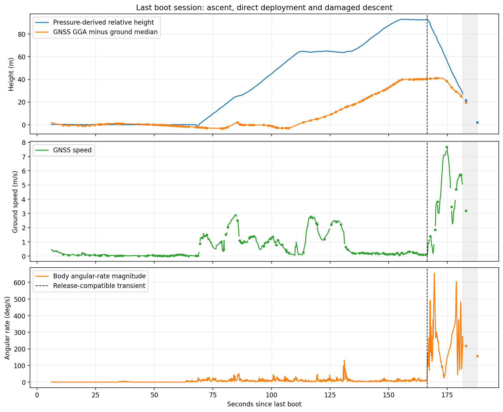
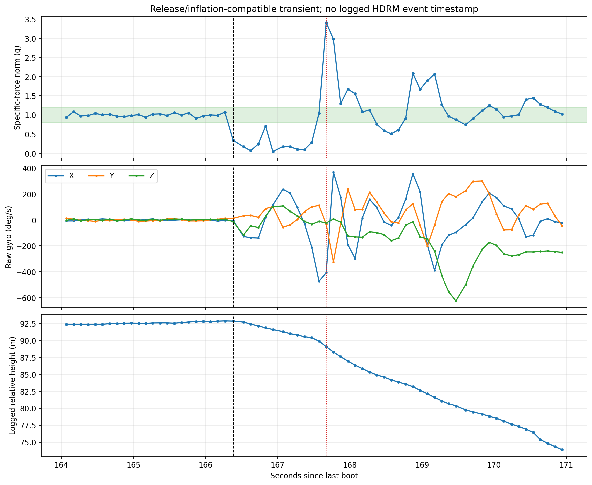
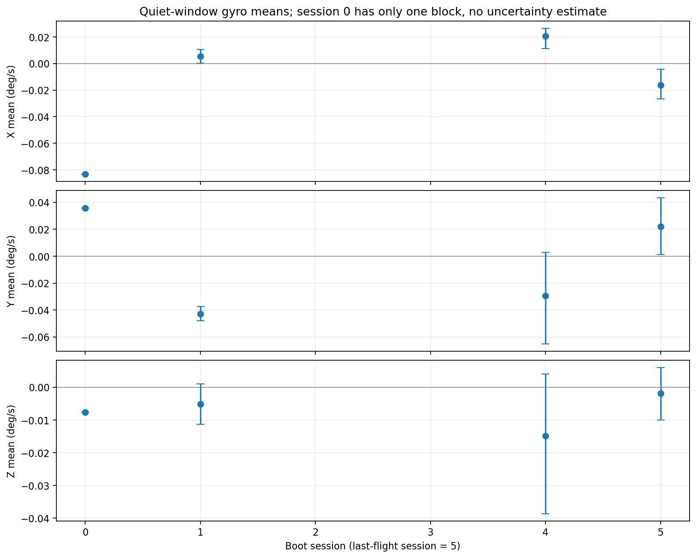
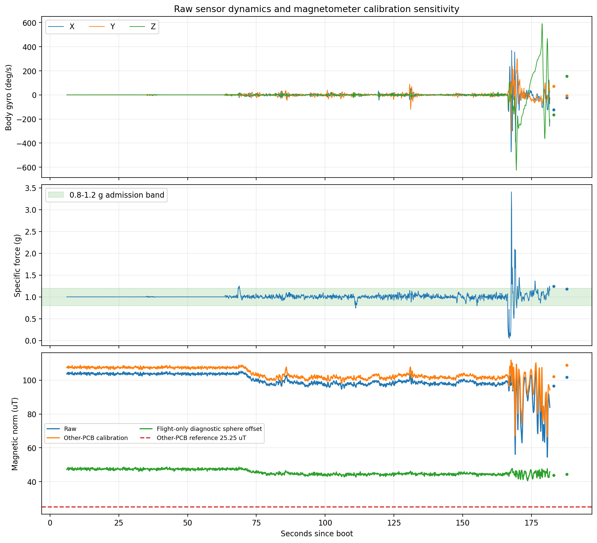
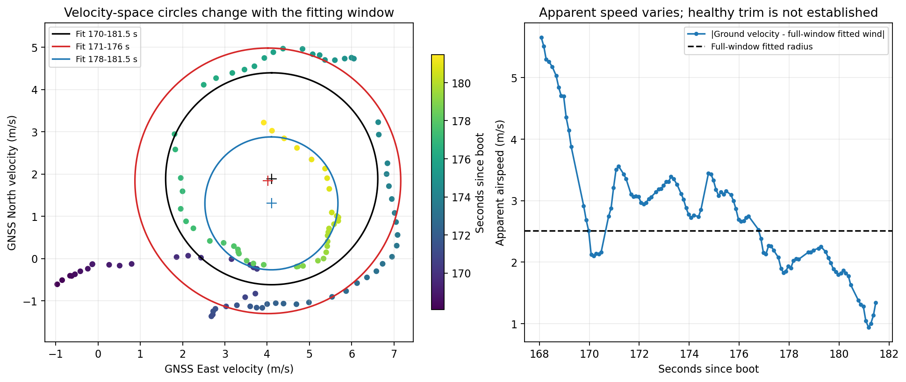
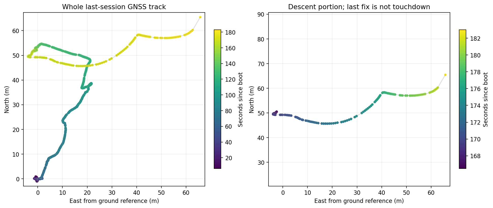
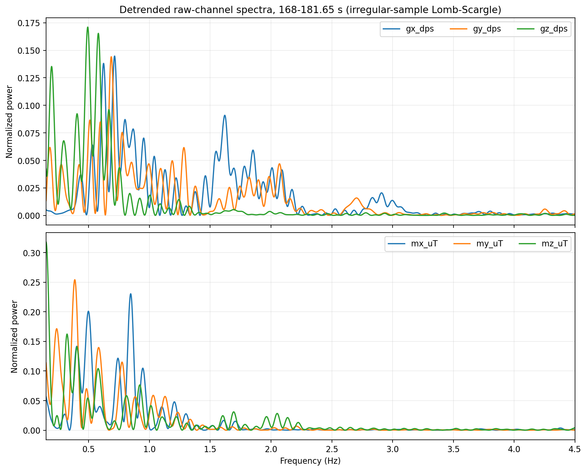

# Damaged parafoil drop: raw-log analysis

Analysis date: 2026-11-01. Run identifier: `Test2_3010`, from the supplied archive directory name. The CSVs contain UTC time of day but no date; the actual flight date is not independently established by these columns.

## Findings that matter for firmware

1. The pressure/IMU trace supports ground preparation, two climbs separated by a hover, top hover, direct release/inflation, and a rapidly rotating damaged descent. There is no modeled or inferred primary-parachute phase.
2. The damaged descent has a pressure-derived sink of about **4.43 m/s**. This is not a measurement of healthy straight-glide sink.
3. Velocity-circle fitting produces a **provisional** wind near **4.52 m/s towards 65 degrees true** in one broad window. A single constant airspeed does not describe the descent well: early and late fitted radii are **3.14 and 1.57 m/s**. Healthy trim speed remains unidentified.
4. The supplied other-PCB magnetic calibration is unsuitable for direct application to these logs. An independently fitted hard-iron offset improves magnetic-norm consistency, but absolute heading remains unvalidated.
5. **290 of 3327 GNSS records (8.72%) are rejected** by schema, units, range and reconstructed checksum checks. Five malformed-coordinate rows pass both checksums. One would create a roughly 7660 km position jump if parsed numerically without format validation.
6. GNSS vertical response is inconsistent with pressure-derived height. Constant datum correction cannot explain it. There is insufficient independent truth to assign the discrepancy entirely to either sensor.
7. Dense IMU recording ends at 181.641 s. Large gaps follow, and the last sample is still about 2 m above the pressure reference with substantial rotation. Touchdown, flare performance and the exact mount-break instant are not established.

No flight-estimator, controller or configuration code was changed. All calibration candidates below are offline results for this dataset.

## Sources, hardware and assumptions

- Original inputs: [GNSS](../gnss.csv), [sensors](../sensors.csv), [restart markers](../restarts.csv). They remain byte-for-byte unchanged; SHA-256 hashes are in [metrics.json](metrics.json).
- The supplied CSVs exactly match `Test_logs/Test2_3010/` inside the supplied ZIP. The ZIP also contains another test, which was not merged into this analysis.
- The user confirmed no application filtering or bias subtraction was performed. Raw values here mean uncalibrated physical-unit outputs: acceleration in m/s2, gyro in deg/s, magnetic readings labelled uT and pressure in Pa. They are not ADC-count columns.
- The CDR identifies **BMI270** and **IIS2MDC** on PDF pages 33 and 48 (printed 31 and 46). The user identifies the actual receiver as **7Semi L89HA-S90**, superseding the CDR's preliminary GNSS selection. [CDR](../../References/CDR_TeamSamarthya_2026_INSPACe_CAN_7USAT_016.pdf).
- Mount/body axis mapping, actual range/ODR/filter register values, UART baud and the HDRM command timestamp were not supplied. No absolute initial pose for this drone installation was assumed.
- The supplied magnetometer calibration used the production PCB; the test used a different temporary PCB. The screenshot's calibration zeros for accel/gyro are not measurements of the test hardware's true offsets.

Hardware context: [Bosch BMI270](https://www.bosch-sensortec.com/en/products/motion-sensors/imus/bmi270) documents programmable ranges and internal sampling/filtering. [ST IIS2MDC datasheet](https://www.st.com/resource/en/datasheet/iis2mdc.pdf) documents magnetometer sensitivity/range. These specifications do not establish the settings used in this log.

## 1. Data integrity and time alignment

### Six separate boot sessions

Do not concatenate `boot_ms` into one continuous flight. Decreasing sensor boot time gives six sessions. For GNSS, grouping by UTC minus boot time also detects a reset that boot-time decrease alone misses: the next session's first fix arrives late enough that its boot time exceeds the preceding session's last logged value.

| Session | Sensor rows | Accepted GNSS rows | Sensor boot-time span, s | Logged relative-height range, m |
| --- | ---: | ---: | --- | --- |
| 0 | 34 | 19 | 8.693-11.996 | -0.026 to 0.151 |
| 1 | 988 | 83 | 6.085-104.970 | -0.248 to 0.320 |
| 2 | 111 | 96 | 6.174-17.609 | -0.164 to 0.066 |
| 3 | 1091 | 823 | 6.088-118.532 | -0.301 to 0.262 |
| 4 | 765 | 650 | 6.184-86.020 | -0.116 to 0.756 |
| **5: flight** | **1693** | **1366** | **6.128-187.821** | **-1.760 to 93.013** |

There are seven rows in the separate restart-marker file, including times later than this flight log. Their count is not a direct count of flights or resets during the descent. There is no boot-time reset within the last recorded flight session.

The last-session UTC-minus-boot median is 38936.731 s. The release-compatible transient at boot 166.384 s therefore corresponds approximately to **10:51:43.115 UTC**. Boot time is the primary common time axis; GNSS message reception/measurement delay remains a limitation.

### GNSS quarantine rather than silent repair

All GNSS rows have 27 CSV fields, so field count alone does not detect corruption. Checks require valid fixed-format NMEA latitude/longitude, hemispheres, units, numeric ranges, consistent knots/kmh, and both reconstructed `GNGGA` and `GNVTG` XOR checksums. The reconstruction is verified against the provided checksum columns, not an assertion that raw serial framing was recorded.

The primary analysis retains **3037 rows** and excludes **290**. Failure categories overlap: 190 fail GGA checksum, 97 fail VTG checksum, 256 have bad units/mode, 224 numeric/range problems and 138 coordinate-format problems. A combined reject is not the sum of these counts. Cleaned data are copies with provenance, not edits to the source.

Five rows (source lines **132, 1202, 1568, 1780, 2460**) have malformed coordinate formatting despite passing both reconstructed checksums. At line 2460, longitude is `4.724842`, not the required `DDDMM.fraction` format. Treating it as an ordinary NMEA number yields about 0.079 degrees east. The dropped prefix can evade XOR because the character XOR of `0725` is zero. **Checksum validation is necessary but insufficient.** Do not restore a guessed prefix and call it a measured fix.

Use [gnss_row_audit.csv](gnss_row_audit.csv) for every acceptance/rejection decision and source-line locator. It also records rows rejected for several reasons.

### Effective recorded cadence

| Last-session quantity | Sensors | Accepted GNSS pairs |
| --- | ---: | ---: |
| Median interval | 0.100 s | 0.100 s |
| Effective rate over recorded span | 9.31 Hz | 7.71 Hz |
| 95th-percentile interval | 0.139 s | 0.304 s |
| Largest interval | 4.692 s | 1.532 s |

Sensor gaps over 0.2 s are 0.218 s at boot 137.491, 1.364 s at 183.005 and 4.692 s at 187.821. The GNSS stream has 134 accepted-fix intervals over 0.2 s. All sensor health flags remain one, so those flags do not describe recording continuity or reference quality.

The observed 0.1 s epoch spacing is not proof of independent navigation bandwidth at 10 Hz. Likewise, logging at about 10 Hz does not prove the physical IMU was acquired or used by an estimator only at that rate. We cannot recover higher-rate dynamics from these files.

A reconstructed GGA+VTG pair is typically **121 serial bytes**. At 10 Hz and 8N1 that alone requires about **12100 bit/s**, before other messages. If the interface was left at 9600 baud, it cannot carry that load. Actual baud is unknown; this is a concrete check, not a diagnosed cause. Buffer handling, blocking writes and serial framing also need inspection. No receiver setting was changed.

## 2. Flight sequence



All times below are seconds since the last boot. These are descriptive analysis windows rather than logged mission-state boundaries.

| Interval | Interpretation | Pressure-height behavior |
| --- | --- | --- |
| 8-64 s | Ground preparation, mostly stationary with some handling | Near zero; detrended RMS 0.084 m |
| 70-110 s | First climb | Approximately +1.45 m/s |
| 112-130 s | Intermediate hover | Approximately 64 m; fitted slope -0.008 m/s |
| 136-150 s | Second climb | Approximately +1.55 m/s |
| 154-164 s | Top hover | Approximately 92.5-93 m |
| 166.384-167.972 s | Release/inflation-compatible transient | Low specific force followed by a load peak |
| 168-181.65 s | Dense damaged-descent data | Approximately -4.435 m/s |
| 183.005, 183.129, 187.821 s | Sparse tail | Last logged relative height 1.974 m |

The height maximum is **93.013 m at 155.715 s**. It occurs during top-hover variation, not necessarily at release. At 166.269 s the sample is still near 1 g and 92.902 m. At 166.384 s its force norm drops to about 0.34 g. The minimum is **0.0474 g at 166.933 s**, and the peak is **3.406 g at 167.672 s**. There is roughly 1.29 s between first low-force observation and peak load.



This is consistent with release followed by inflation/loading, matching the user's direct-HDRM description. It does not identify electrical HDRM energization time or prove precisely when the servo mount broke. The raw sample interval and sensor/pressure dynamics also limit event-time precision.

There is no terminal impact or settled post-landing interval. At 187.821 s, angular-rate magnitude is still about 156 deg/s. Do not interpret that last sample as touchdown.

## 3. Calibration that the logs support

### Gyroscope: stationary residual zero-rate offsets

Quiet two-second candidate blocks are selected only in ground intervals: at least 12 samples spanning at least 1.4 s, component gyro SD below 0.18 deg/s, acceleration-component SD below 0.035 m/s2, mean gyro norm below 0.6 deg/s and height SD below 0.15 m. These are offline selection choices, not new flight validity settings.

The last session contributes **212 samples in 11 quiet blocks**, spread between 10.020 and 61.970 s. Its estimated mean is:

```text
gyro bias [X,Y,Z] = [-0.016392, +0.022066, -0.001821] deg/s
corrected gyro   = raw gyro - bias
rad/s input      = corrected gyro * pi/180
```

Conditional two-second-block bootstrap 95% intervals are approximately X [-0.0266,-0.0043], Y [0.0013,0.0433], Z [-0.0100,0.0060] deg/s. Sample SDs are about [0.090,0.132,0.091] deg/s. The intervals describe variation in selected blocks; unrecognized motion, Earth rotation and systematic sensor errors are not fully represented. Displayed digits make the calculation reproducible, not equally precise physical knowledge.



Other usable sessions have different means. Session 0 has only one accepted block, so no block-to-block uncertainty interval can be estimated; sessions 2 and 3 have no blocks meeting these conservative criteria. Do not treat these sessions as a controlled power-cycle/temperature experiment. A fresh stationary bias estimate remains preferable to reusing one universal vector.

Only zero-rate bias is inferred. Gyro scale, cross-axis matrix, in-flight temperature response and dynamic attitude error cannot be calibrated here. Removing this small bias does not cure the large rotational dynamics or the late recording gaps.

### Accelerometer: do not subtract gravity as bias

The selected flight-ground mean is approximately **[2.43245,0.32688,9.49581] m/s2**, with median norm **9.80820 m/s2**. A static tilt can explain nonzero X/Y; the mounting pose for this test was not provided. Subtracting the whole mean would erase the gravity-related specific-force vector needed for attitude.

A hypothetical common gain to force that norm to standard g is 0.999842, only a 0.016% change. It was **not applied**: one can trade bias against scale and unknown pose, and standard g is not an independently measured local reference. Other quiet poses remain on a narrow gravity-direction cap rather than providing a controlled six-face calibration.

**A full accelerometer bias/scale/misalignment calibration is not identifiable from these records alone.** It is deliberately unavailable in the candidate JSON, rather than replaced with invented fitted coefficients. Raw acceleration is retained for the dynamics analysis.

### Barometer: ground reference, not absolute-pressure calibration

Median pressure in selected ground blocks is **100836.3 Pa**. Using the same standard-atmosphere relative-height formula with that ground reference gives a final height about **2.00 m**. Inverting the logged altitude relation infers its original reference near **100835.97 Pa**, with only about 0.018 Pa scatter, consistent with rounding/formula details. The logged relative altitude is therefore a transformation of pressure, not a second independent height sensor.

Selected ground-block height SD is about **0.104 m**. Hover residuals include actual drone motion and pressure-port effects. Good repeatability does not by itself calibrate absolute height, temperature-dependent conversion or sensor lag. Chip temperature around 32 C is not an independently measured atmospheric temperature profile.

Temperature sensitivity is much smaller than the GNSS discrepancy: an isothermal hypsometric calculation for the same pressure change gives about 93.1 m at mean air temperature 288.15 K and 98.0 m at 303.15 K. These are conditional examples, not a correction applied using chip temperature. A warmer atmosphere could help explain a nominal 100 m drone drop reading around 93 m; it cannot explain the roughly 52 m difference between the pressure and GNSS relative-height maxima.

### Magnetometer: other-PCB calibration versus diagnostic flight fit

The [supplied reference screenshot](mag_reference_other_pcb.png), preserved unchanged, is interpreted as:

```text
b = [-5.84, 3.08, 11.92] uT
M = [[1.001, 0.012, 0.009],
     [0.012, 1.006,-0.001],
     [0.009,-0.001, 0.994]]
candidate corrected reading = M * (raw - b)
reference magnitude = 25.25 uT
```

Its preflight corrected norm is about **107.42 uT**, far from 25.25 uT. The near-identity mapping cannot compensate the installation mismatch. This agrees with the user's warning that the PCB/environment differs; it is not evidence that the sensor itself has saturated.

A hard-iron-only geometric sphere fit on the **168-181.65 s descent window** yields:

```text
diagnostic offset = [-39.63, +4.58, -44.14] uT
fitted radius     = 44.56 uT
radial RMS        = 1.69 uT
```

Early/late-half training gives offset vectors differing by several uT; held-out-half radial RMS is about 1.85-2.10 uT. This is useful evidence of a large installation-specific offset. It is not a full soft-iron/axis-alignment calibration and is not automatically deployable. Constant local interference, motion-related interference and field variation remain confounded without an independent reference.

The `dmx/dmy/dmz` fields are **raw minus a constant per-boot reference**, exactly to file precision. In session 5 that reference is [-75.9715,26.4670,-65.9555] uT. These differences are not calibrated geomagnetic components: subtracting the initial field also removes the Earth's field at that initial pose. The analysis uses `mx/my/mz`, not `dm*`, for magnetic fitting.

Absolute yaw and the payload-to-canopy heading discrepancy cannot be validated from these logs, this calibration screenshot and GNSS course alone.



## 4. Pressure and GNSS altitude disagree materially

The last-session ground GNSS median over 8-60 s is **41.9955 m MSL**. Its maximum is **83.109 m MSL at 170.971 s**, only **41.1135 m above that ground reference**, versus the pressure-derived maximum near 93 m. The GNSS maximum also occurs after the release-compatible transient.

GGA altitude is MSL and geoid separation is a different field, as documented in [Quectel's protocol specification, GGA section](https://quectel.com/content/uploads/2024/02/Quectel_L89_R2.0_GNSS_Protocol_Specification_V1.0.pdf). The comparison removes the GNSS ground baseline. A constant ellipsoid/geoid conversion cannot reconcile different relative amplitudes and timing.

A descriptive lag-plus-gain sweep has its minimum near 44.4 s lag and gain 0.613, with about 2.56 m RMS over the selected window. Without lag, even fitting gain/offset leaves about 11.19 m RMS. **44.4 s is not a measured receiver latency and must not become a compensation constant.** The model also needs an implausibly large gain change and lacks independent altitude truth. This is a diagnostic description of the mismatch.

Possible contributors include receiver navigation behavior, multipath, static-navigation configuration, timing/serialization issues, pressure-port aerodynamics and pressure-height modeling. The CSVs do not isolate them. The user reports no application filtering; receiver-internal processing is still possible. Quectel documents a configurable static-navigation threshold, but its actual value was not logged, so it is not diagnosed as the cause.

Use pressure-derived height as the provisional relative-height measurement already chosen in the design, while checking this discrepancy against drone flight-controller altitude or another independent reference. Do not regress pressure height onto this GNSS trace and call it a barometer calibration.

## 5. Descent dynamics and specific-force validity

The dense 168-181.65 s pressure-height slope is **-4.4348 m/s**, with 0.446 m residual RMS. Including the sparse tail gives -4.4117 m/s. Subwindows give about 4.58 m/s at 170-176 s and 4.13 m/s at 176-181.7 s. The mean descent is fairly steady despite changing rotational motion.

Peak absolute raw gyro components in the flight are approximately **[473.1,324.4,624.5] deg/s**. These are body-axis rates, not automatically Euler heading rate. No trace proves the healthy canopy's turn-rate limit or turn radius. Nor does the CDR's maximum sensor capability prove the active range register setting.

**84.6% of samples in the dense damaged descent pass the 0.8-1.2 g magnitude band**, despite the aggressive rotation. This does not prove every passing acceleration vector is wrong. It demonstrates that a magnitude gate alone does not certify a gravity reference or automatically detect this damaged regime. Aerodynamic/centripetal forces can affect vector direction while its magnitude remains near g.

Do not identify the normal straight sink rate, 20% turn-loss multiplier, healthy glide ratio or control gains from this asymmetric damaged descent. In particular, 4.43 m/s is not suitable as `straight_sink_rate_mps` merely because it is well fitted.

At this observed sink, two seconds costs about 8.9 m of height. That makes the existing planning interval/reserve assumptions worth testing near terminal flight; it does not directly justify retuning them from this one faulted run.

## 6. Velocity-circle method applied to this flight

GNSS ground velocity is reconstructed from the accepted VTG speed/course. Knots and km/h agree within their rounding resolution. Course is a direction of ground motion, not canopy yaw. Only the descent windows enter parafoil fits; ascent velocities belong to the drone-carried configuration.

Low ground speed actually occurs near and after release: six of 121 accepted fixes between 166.384 and 181.65 s report less than 0.5 m/s, with a minimum near **0.083 m/s**. Course repeats while speed is small. This does not establish the canopy stopped flying; it means that assuming useful ground course is always available is unsupported. A precise-looking course value at near-zero ground speed is not a validated starting orientation for replanning.

Following the velocity-circle relation in [Sandia's parafoil report, printed pp. 12-13](https://digital.library.unt.edu/ark:/67531/metadc671463/m2/1/high_res_d/270670.pdf), two solvers are compared: centered algebraic least squares and nonlinear geometric radial least squares. The second minimizes actual radius residuals. It is an offline scientific reference, not the MCU implementation.

| Window, boot s | Samples | Wind N, m/s | Wind E, m/s | Fitted maneuver speed, m/s | Radial RMS, m/s |
| --- | ---: | ---: | ---: | ---: | ---: |
| 165-183.1 | 132 | 1.940 | 2.810 | 3.179 | 0.957 |
| 170-181.5 | 94 | 1.888 | 4.109 | 2.509 | 0.667 |
| 171-176 | 42 | 1.839 | 4.017 | 3.144 | 0.211 |
| 174-178 | 32 | 2.385 | 4.388 | 2.539 | 0.151 |
| 178-181.5 | 28 | 1.305 | 4.102 | 1.574 | 0.128 |

All twelve evaluated windows, including poorer/short-arc fits, are in [circle_fit_windows.csv](circle_fit_windows.csv); the table above must not be read as a preselected acceptance rule.



The 170-181.5 s fit corresponds to **wind towards 65.3 degrees**, magnitude **4.52 m/s** (meteorological wind-from bearing would be about 245.3 degrees). The model gives about 331 degrees of fitted velocity-direction coverage. Its RMS is 26.6% of the radius, so this is not a clean constant-speed circle. A 1 s block-bootstrap gives conditional ranges roughly WN 1.28-2.34, WE 3.23-4.65 and radius 1.99-3.01 m/s. These are fit-sensitivity intervals, not independently validated wind uncertainty.

Early and late windows have substantially different fitted radii. Applying the early model to late data gives about 1.41 m/s radial RMS; reversing train/test gives about 1.54 m/s. Good same-window residuals do not validate transfer to a different portion of this descent. Changing actual speed, brake tension, wind or receiver response could contribute; the data do not uniquely separate them.

**Provisional conclusion:** wind is plausibly of order 4-5 m/s towards the NE/ENE, but a certified value is unavailable. The damaged maneuver's horizontal speed is not one constant and is not a measurement of healthy `Vtrim`. It would be particularly unsafe analytically to average the different radii and label the result trim.

The fitted air-relative velocity direction rotates at about 0.14 Hz in the broad window, conditional on that fitted wind. This is not proof that canopy yaw or payload yaw has the same rate. The ground track mainly drifts east/northeast; it is not a clean ground-fixed circle. If the provisional wind-greater-than-maneuver-speed relationship is real, a full ground-fixed circle is infeasible in that damaged state, even though air-relative turning continues. Healthy-flight feasibility remains unknown.



A settled healthy brakes-released leg after a suitable wind estimate is still needed to estimate trim with `|Vground-W|`. This flight supplies no demonstrated interval in that condition. No healthy trim speed has been inserted into common configuration.

## 7. What the spectra can and cannot say

The dense descent window is about 13.6 s, giving nominal frequency discrimination only around **0.074 Hz** before accounting for nonstationarity and gaps. The analysis uses detrended, irregular-sample Lomb-Scargle spectra rather than pretending the sampling is perfectly uniform.

| Raw channel | Largest interior peak over 168-181.65 s |
| --- | ---: |
| Gyro X | 0.71 Hz |
| Gyro Y | 0.69 Hz |
| Gyro Z | 0.49 Hz |
| Mag X | 0.85 Hz |
| Mag Y | 0.39 Hz |
| Mag Z | 0.32 Hz |



Peaks move between earlier and later subwindows: for example mag Y is about 0.42 Hz early and 0.59 Hz late. The full spectrum contains broad/multiple components rather than a single stable oscillation. Values near a search boundary may be trends rather than resolved periodic motion. Full rankings and window resolutions are in [spectral_peaks.csv](spectral_peaks.csv).

These are raw payload sensor-channel frequencies, not measured canopy-heading oscillations. Nominal 10 Hz logs cannot establish high-frequency behavior above about 5 Hz, and lack of logged hardware bandwidth/anti-alias settings matters. Payload rotation/twist, translation, aerodynamic loading and magnetic installation effects are confounded. Do not select a canopy-heading EMA constant or declare a validated attitude filter from this faulted run alone.

No absolute attitude trace is presented as truth: the current mounting axes/pose, representative magnetic calibration, independent canopy heading and data across late gaps are missing.

## 8. How well does constant-velocity propagation match this GNSS track?

For each dense-descent start, predict `p(t+dt)=p(t)+vGNSS(t)*dt` and compare against later GGA positions, interpolating only within the dense recorded section. This is a same-receiver consistency test, not independent position accuracy.

| Horizon | Median horizontal residual | 95th percentile |
| --- | ---: | ---: |
| 0.1 s | 0.12 m | 0.31 m |
| 0.5 s | 0.82 m | 1.57 m |
| 1 s | 2.16 m | 3.89 m |
| 2 s | 6.51 m | 9.27 m |

The results support distinguishing short between-fix interpolation from longer GNSS-loss dead reckoning. Continuing a propagated state is possible; treating it as equally accurate for arbitrarily long periods is not supported. They do not identify a replacement propagator or establish a final outage cutoff.

## 9. Consequences and remaining evidence

The simpler planner/guidance architecture need not be abandoned because of this run. The following assumptions remain open:

- Use a representative installation-specific magnetic calibration and verified sensor/body mapping before judging true heading or payload-to-canopy mismatch.
- Keep the velocity-circle identification proposal, but qualify it with fit consistency and actual steady-state observations. Infer trim only in the appropriate brake state.
- Do not replace healthy airspeed, sink, radius or controller parameters with damaged-flight measurements.
- Fix/diagnose logging integrity and timestamp/serial configuration before treating flags as sufficient validity. Preserve measurement time independently of receive/log time where possible.
- Check the large GNSS/baro altitude discrepancy with independent drone altitude/event/video data. Do not make an automatic GNSS-derived barometer correction from this trace.
- Record actual brake position/line tension if available, release/HDRM commands and mount-failure/impact video timing. These CSVs contain no brake command or actuator feedback fields.
- Validate propagation degradation and late-loop/sample gaps separately from sensor I2C health flags. This analysis does not delegate degraded guidance or flare responsibility to main FSW.

The failed mechanical configuration is valuable fault evidence, but it is not a substitute for normal-flight system identification or terminal-landing validation.

## Reproduction and files

Run `python tools/analyze_flight_data.py` from the repository root with NumPy, pandas, SciPy and Matplotlib. Exact versions, random seed context and source hashes accompany the outputs. The script leaves inputs unchanged, audits every GNSS row, separates sessions, estimates offline calibration candidates, fits circles/spheres, tests sensitivity and generates seven figures. Interpretation and selected phase windows are explicit in this report and script.

- [Metrics](metrics.json), [calibration candidates](calibration_candidates.json), [verification](verification.json).
- [Boot sessions](boot_sessions.csv), [quiet windows](stationary_windows.csv), [phase statistics](phase_statistics.csv).
- [GNSS audit](gnss_row_audit.csv), [accepted GNSS](gnss_validated.csv), [flight GNSS](flight_gnss_derived.csv), [flight sensors](flight_sensors_derived.csv).
- [Recording gaps](sensor_record_gaps.csv), [circle windows](circle_fit_windows.csv), [propagation residuals](propagation_residuals.csv), [spectral peaks](spectral_peaks.csv), [height sensitivity sweep](height_lag_sensitivity.csv).

Additional primary reference for interpreting GNSS fields/configuration: [Quectel L89 R2.0 protocol](https://quectel.com/content/uploads/2024/02/Quectel_L89_R2.0_GNSS_Protocol_Specification_V1.0.pdf). Its documented configuration capabilities are not proof of the actual firmware version or settings used in this test.
